# Práctica Docker

## Ejercicio 1

### 1.1 No uso Alpine pero dejo unas capturas de como he bajado la imagen
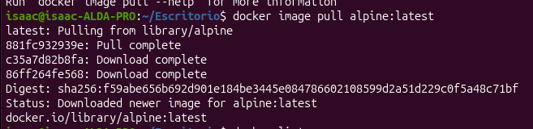

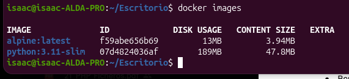

---

## Ejercicio 2

### 2.1 Buscar por terminal la imagen hello-world
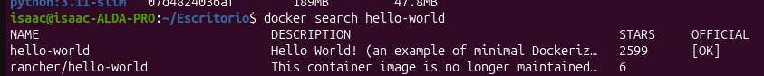

### 2.2 Buscar en DockerHub con la casilla "Docker Official Image" y comprobar que coincide
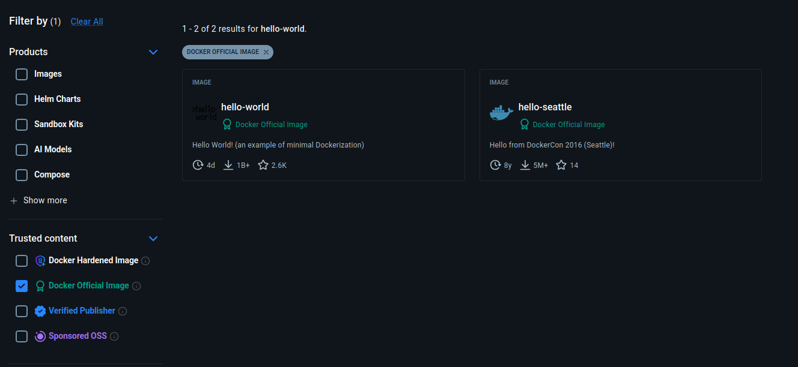

### 2.3 Descargar y ejecutar la imagen elegida
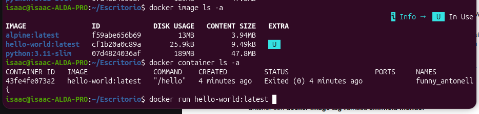

### 2.4 Descargar y ejecutar la imagen hello-seattle
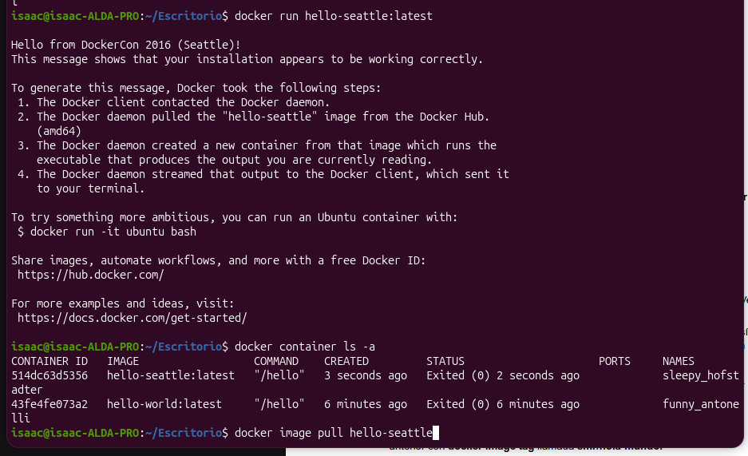

### 2.5 Intentar borrar la imagen hello-seattle ¿Por qué da error?
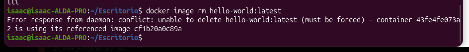
Da error porque está activa, habría que forzar el borrado

### 2.6 Listar los contenedores con `ls -a` ¿Para qué sirve la opción -a?
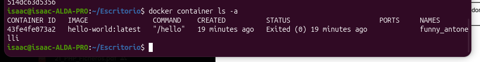

### 2.7 Eliminar el contenedor que usa hello-seattle y la imagen
No tengo la captura pero se elimina mediante "docker container rm -f nombre_contenedor", el -f es la clave

---

## Ejercicio 3

### 3.1 Crear la imagen smr/hola-mundo con `docker image tag`
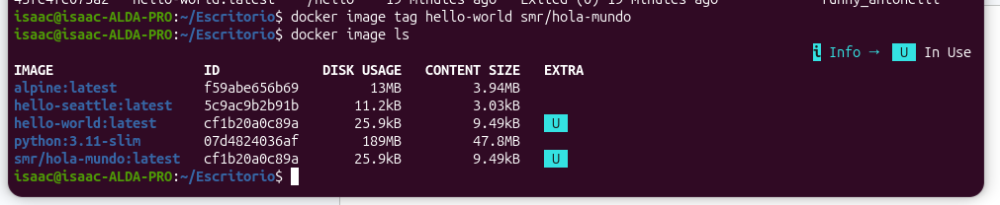

### 3.2 Borrar la imagen original (hello-world)
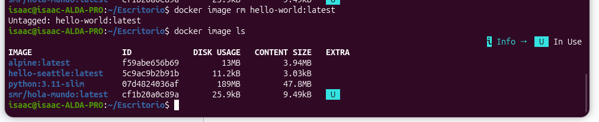

### 3.3 Guardar la nueva imagen en el fichero smr-hola-mundo.tar
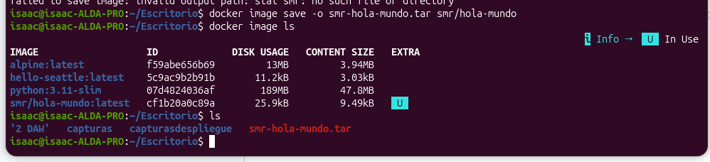

### 3.4 Borrar la imagen smr/hola-mundo y comprobar que no hay imágenes
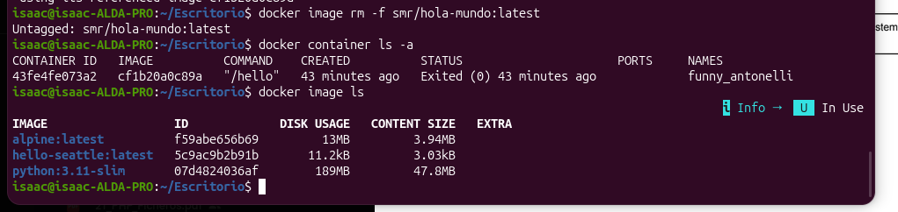

### 3.5 Añadir la imagen con `docker image load` usando el .tar
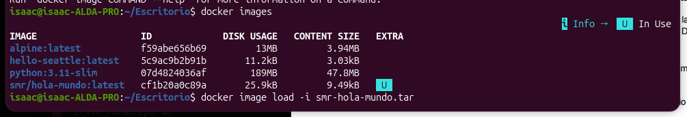

---

## Ejercicio 4

### 4.1 Descargar la imagen oficial de mysql
### 4.2 Crear el contenedor mysql_smr con password de root "smr"
### 4.3 Ejecutar `docker container exec -it mysql_smr mysql -u root -p`
### 4.4 Comprobar que se puede conectar al MySQL del contenedor
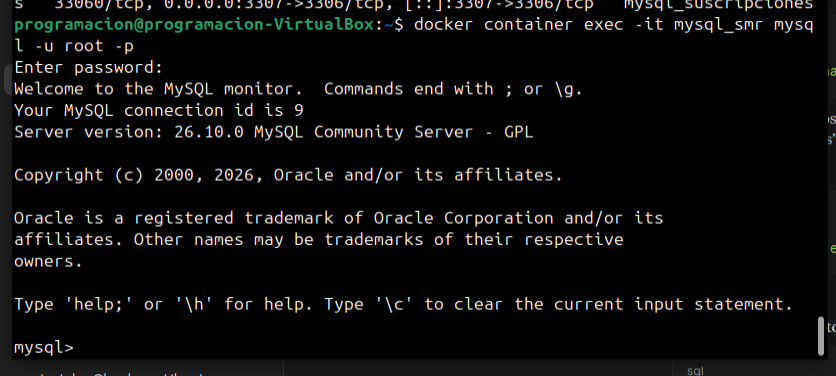

### 4.5 Crear la base de datos con `CREATE DATABASE prueba;`
### 4.6 Comprobar que se ha creado con `show databases;`
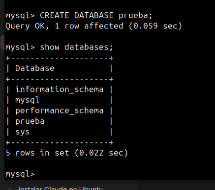

---

## Ejercicio 5

### 5.1 Parar el contenedor mysql_smr y volver a iniciarlo
### 5.2 Conectarse de nuevo a MySQL y comprobar que la bbdd prueba sigue estando
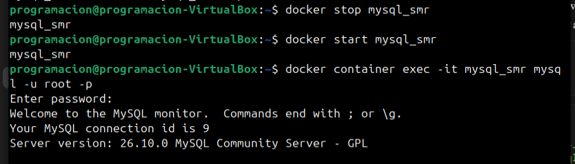
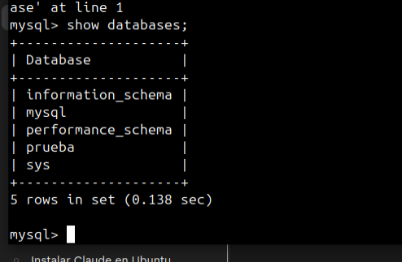

### 5.3 Eliminar el contenedor mysql_smr
### 5.4 Volver a crearlo con los mismos parámetros y comprobar que la bbdd prueba no existe
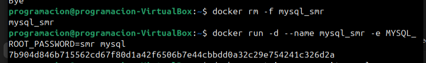
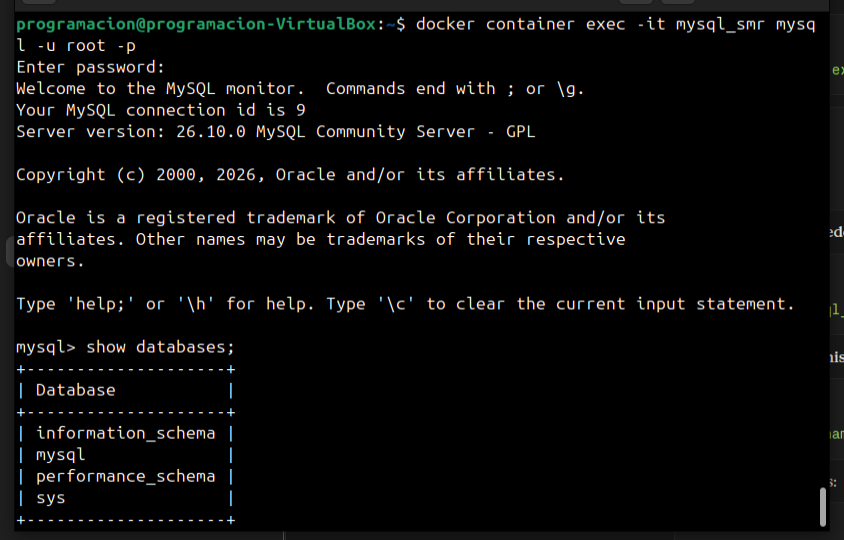

---

## Ejercicio 6

### 6.1 Crear el directorio mysql_data
### 6.2 Crear el contenedor mysql con /var/lib/mysql guardado en mysql_data
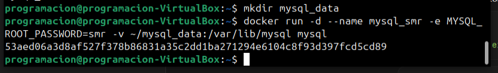

### 6.3 Crear de nuevo la bbdd dentro del MySQL del contenedor
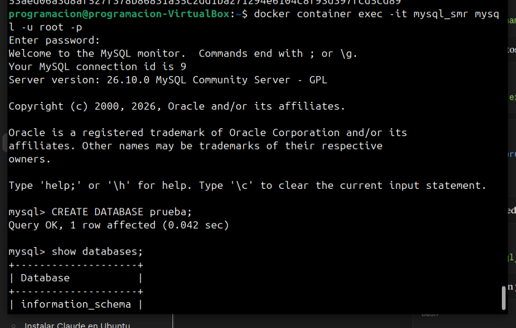

### 6.4 Salir y eliminar el contenedor
### 6.5 Crear el contenedor sin volúmenes y comprobar que la bbdd no existe
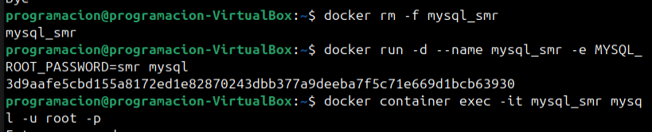
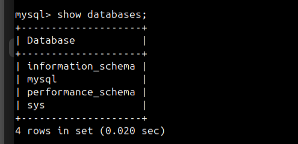

### 6.6 Salir y eliminar el contenedor
### 6.7 Crear el contenedor mapeando la carpeta a mysql_data
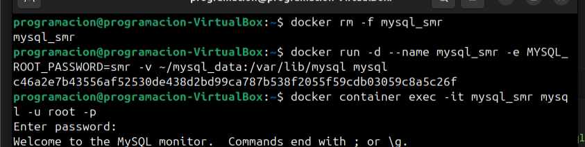

### 6.8 Comprobar que la bbdd sigue estando en MySQL
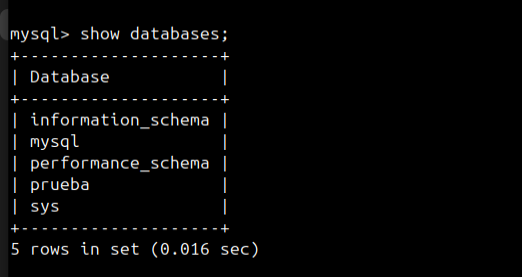

---

## Ejercicio 7

### 7.1 Crear el directorio php_data
### 7.2 Crear el archivo index.php con `phpinfo();`
### 7.3 Arrancar el contenedor php_smr (php:8.0-apache) con volumen y puerto 8085
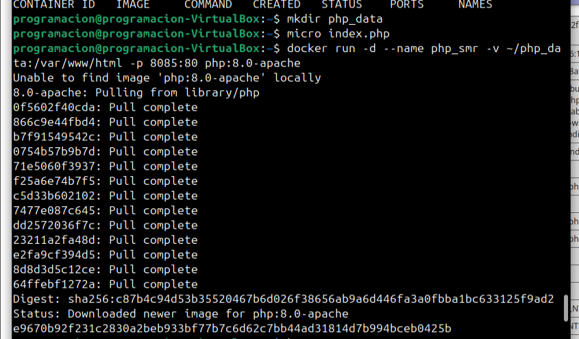

### 7.4 Acceder desde el navegador a http://ip_maquina_virtual:8085
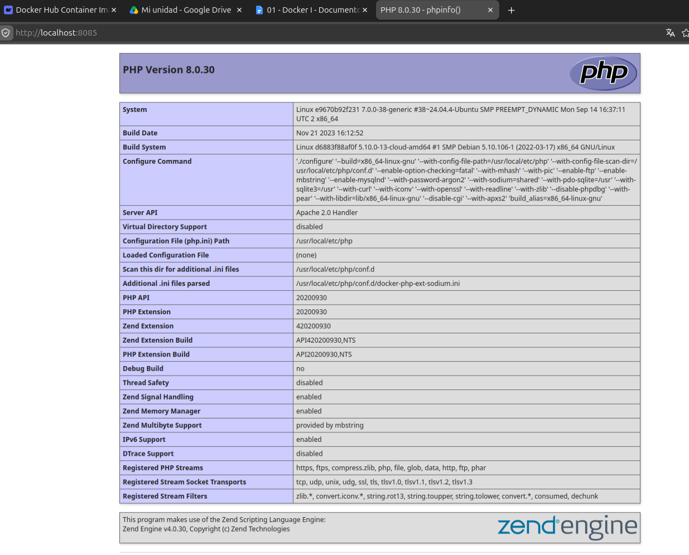

### 7.5 Reiniciar la máquina virtual
### 7.6 Comprobar que la URL da error
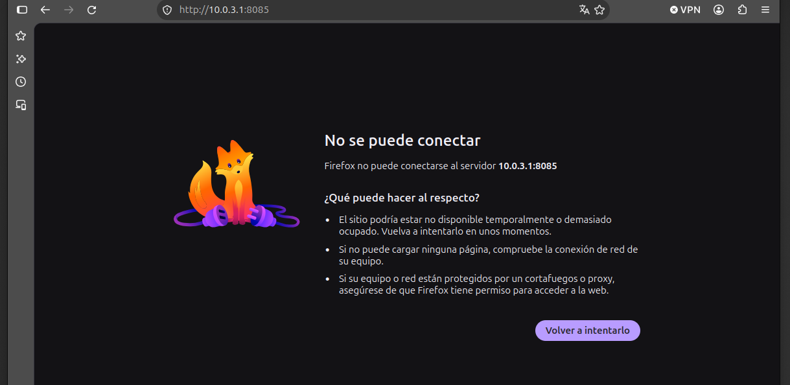

### 7.7 Borrar el contenedor
### 7.8 Crear de nuevo el contenedor con reinicio automático (siempre)
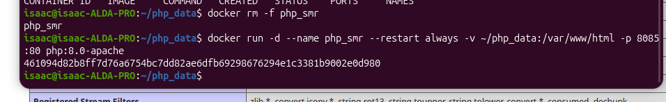

### 7.9 Reiniciar la máquina virtual
### 7.10 Comprobar que la URL ahora sí funciona
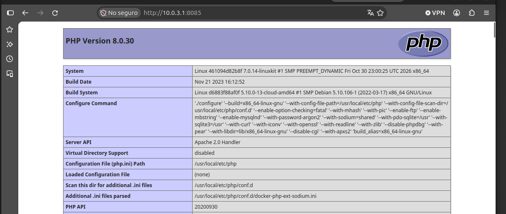
